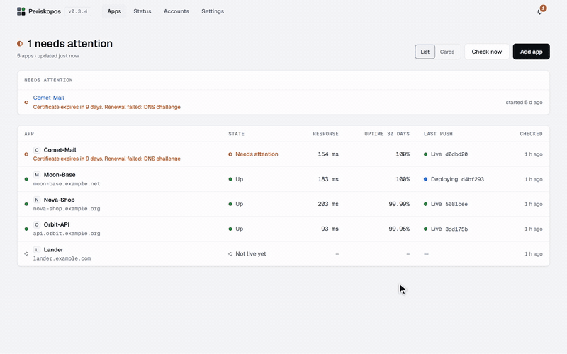

<p align="center">
  
</p>

<h1 align="center">Periskopos</h1>

<p align="center">
  <strong>Every app you ship, watched from one window.</strong><br>
  A desktop app that tells you what's down, what's live and what's about to break, across every service your apps run on.
</p>

<p align="center">
  <a href="https://github.com/periskopos/periskopos/actions/workflows/checks.yml"></a>
  <a href="https://github.com/periskopos/periskopos/releases/latest"></a>
  <a href="LICENSE"></a>
  
</p>

<p align="center">
  <a href="https://periskopos.com"><strong>Website</strong></a> ·
  <a href="https://periskopos.com/docs/"><strong>Docs</strong></a> ·
  <a href="https://github.com/periskopos/periskopos/releases/latest"><strong>Download</strong></a> ·
  <a href="https://github.com/periskopos/periskopos/discussions"><strong>Discussions</strong></a>
</p>

<p align="center">
  <picture>
    <source media="(prefers-color-scheme: dark)" srcset=".github/assets/walkthrough-dark.gif">
    
  </picture>
</p>

Each app you run in production lives across a host, a database, a domain,
CI, maybe a payments account and an error tracker, each with its own
dashboard. Periskopos is a desktop app that reads them all and tells you, in
one window, what's down, whether your last push actually went live, what's
misconfigured and what's about to expire, before a user does.

You connect each account (Cloudflare, GitHub, Render, Supabase, Vercel,
Stripe…) once with a key you create, and Periskopos suggests what to watch
for each app. Nothing changes in your apps.

It runs entirely on your computer. Your keys never leave it, it only reads
unless you switch on actions for an account, and AI assistants can ask it
questions through MCP without ever seeing a key.

The name is coined from the Greek *peri* (around) and *skopos* (lookout):
the one who keeps watch all around. It was called Ground Control until
0.3.0.

## Features

| | |
|---|---|
| **Is it up, and is it live?** | Uptime checks with 30 days of history, commits and CI, deploys, and whether the last push is what's serving. |
| **Dependencies watched for you** | TLS certificates, domain registrations, databases, email domains, payment webhooks, and the status pages of the providers your apps use, counting only the parts they actually use. |
| **Configuration checks** | Missing security headers, unsafe DNS, branch protection, Supabase row level security, Cloudflare SSL settings and more, each with why it matters and exactly how to fix it. |
| **Errors and logs** | Recent runtime errors from your host's logs and unresolved issues from Sentry, with an alert when errors spike. |
| **Traffic, search and revenue** | Cloudflare analytics, Google Search Console, Google Analytics, Stripe and Paddle, on each app's overview. |
| **The World** | Your own Silicon Valley, drawn from your real data: a campus for each app, the services they rely on behind them, and the watcher's dish on a hill. Lights only when the state is known, smoke when one's down, fog when it isn't known, real checks and deploys on the road, a key that takes you to what needs a look, and a slider to replay the last 24 hours. It grows as your apps do. |
| **Notifications** | On the desktop and on your phone (ntfy, Telegram or email), only when something actually changes. |
| **Actions with a confirmation** | Redeploy, purge cache, or your app's own buttons, every run recorded with who started it. |
| **AI assistants (MCP)** | Claude, Cursor, VS Code and others can ask "is my last push live?" or "why is CI failing?", and can only *ask* to run an action: you approve each one. |
| **A small protocol** | Your app can implement it to show its own numbers and offer its own buttons. Periskopos generates the code. |
| **No change to your apps** | Everything else works from the outside, through the providers' APIs. |

## Supported services

| Kind | Services |
|---|---|
| Hosting | Cloudflare Workers & Pages, Render, Vercel, Netlify, Fly.io, Railway, DigitalOcean App Platform, AWS Amplify, Supabase Edge Functions |
| Source and CI | GitHub (including Dependabot and secret scanning alerts), GitLab |
| Databases | Supabase, Neon, MongoDB Atlas |
| Domains and DNS | Cloudflare, any domain (RDAP registration, certificates, SPF/DMARC/CAA) |
| Errors and logs | Sentry; runtime logs from Vercel, Render, Railway, Cloudflare Workers, Supabase, DigitalOcean and Fly.io |
| Analytics | Cloudflare analytics, Google Search Console, Google Analytics |
| Payments | Stripe, Paddle |
| Email | Resend, SendGrid |
| Other | Clerk, OpenAI spend |

Each is set up with a key you create, read-only wherever the provider allows
it. [Providers](https://periskopos.com/docs/accounts/providers/) lists the exact permissions for
each one. New providers are welcome: see [CONTRIBUTING.md](CONTRIBUTING.md).

## Install

Download the latest installer from
[Releases](https://github.com/periskopos/periskopos/releases/latest). The
installed app keeps itself up to date.

- **Windows:** `Periskopos-Setup-<version>-x64.exe`. The installer is
  unsigned, so SmartScreen says "unknown publisher": choose More info, then
  Run anyway.
- **macOS:** `Periskopos-macOS-<version>-arm64.dmg` (Apple silicon) or
  `-x64.dmg` (Intel). The app is unsigned, so the first time macOS won't
  open it: choose Done, then System Settings → Privacy & Security → Open
  Anyway. Unsigned, it can't update itself; it tells you when there's a new
  version and opens the download.
- **Linux:** `Periskopos-<version>-x86_64.AppImage`. Make it executable
  (`chmod +x`) and run it; it updates itself.

## Getting started

1. Open Periskopos and add your first app from its address. Its site,
   certificate, domain and configuration are checked at once, before any
   account is connected.
2. On **Accounts**, choose **Connect an account** and paste a key for a
   service you use. The setup lists the permissions it needs.
3. On the app's page, **Get more from this app** suggests what each
   connected account can add, and connects the obvious ones in one click.

Keys are saved to `.env.local` in your profile's Periskopos folder,
encrypted by the installed app, and never in the database, a backup or the
browser. See
[Keys](https://periskopos.com/docs/accounts/keys/).

## AI assistants

Switch on **Settings → AI assistants → Let AI assistants use
Periskopos**, then copy the command from **Connect an assistant**. For Claude
Code it looks like:

```bash
claude mcp add --scope user periskopos node "<install folder>/resources/app/mcp/main.ts"
```

Assistants get nine read-only tools (`list_apps`, `get_app`, `check_app`,
`get_failure_log`, `get_configuration`, `get_history`, `get_traffic`,
`list_services`, `list_actions`) and `run_action`, which always waits for
your approval in Periskopos. Each assistant can be limited to some apps,
to reading only, or to specific actions. See [Connecting an assistant](https://periskopos.com/docs/assistants/connect/)
and [Limits and approvals](https://periskopos.com/docs/assistants/limits/).

## How it keeps your accounts safe

- The server listens on `127.0.0.1` only, and opens only in its own window:
  each launch makes a key that exists only in memory.
- Keys never leave your PC except to the provider they belong to, and no
  tool or page ever returns one.
- Everything is read-only by default. Actions are opted into per account and
  always confirmed; dangerous ones ask you to type the app's name.
- AI assistants can read and ask, never act on their own.

The [security model](https://periskopos.com/docs/assistants/security/) is the threat model: what
this protects against and what it doesn't. Its full design record is
[docs/AGENT-SAFETY.md](docs/AGENT-SAFETY.md).

## Running from source

Needs [Node.js](https://nodejs.org) 24 or newer. Nothing else is installed
system-wide.

```bash
git clone https://github.com/periskopos/periskopos.git
cd periskopos
npm install
npm run dev
```

`npm run dev` opens the desktop app from your checkout with its own data
folder, beside any installed copy. `npm run check` type-checks, runs the
tests and builds the UI. [CONTRIBUTING.md](CONTRIBUTING.md) has the rest.

## Documentation

The docs for using Periskopos are at **[periskopos.com/docs](https://periskopos.com/docs/)**:

| | |
|---|---|
| [Getting started](https://periskopos.com/docs/getting-started/) | Install, add an app, connect an account |
| [Watching your apps](https://periskopos.com/docs/guide/apps/) | Checks, configuration, runtime errors, status pages, notifications |
| [The World](https://periskopos.com/docs/guide/world/) | Your apps as a valley, and how to read it |
| [Providers](https://periskopos.com/docs/accounts/providers/) | Each account's key and what it watches |
| [AI assistants](https://periskopos.com/docs/assistants/connect/) | Connecting an assistant and setting its limits |
| [Security model](https://periskopos.com/docs/assistants/security/) | What assistants can and can't do, and why |
| [The protocol](https://periskopos.com/docs/protocol/) | Letting an app report its own numbers and actions |
| [The desktop app](https://periskopos.com/docs/app/desktop/) | The tray, updates, backups, where things live |

For working on Periskopos itself, this repository keeps:

| | |
|---|---|
| [Agent safety](docs/AGENT-SAFETY.md) | The security design record, cited throughout the code |
| [Design](docs/DESIGN.md) | The design system: its rules, tokens and components |
| [Releasing](docs/RELEASING.md) | For maintainers |

Star-Map, Moon-Base and the other apps in the examples, tests and screenshots are made up.

## Free, and what will cost money

Periskopos is free and open source (Apache-2.0), all of it: everything that
runs on your computer, for as many apps as you run, with no account. Nothing
in the app will move behind a payment.

Later, **Watchtower** will be an optional paid service for what needs a
server running all the time: checking your sites while your computer is off,
phone alerts whenever something breaks, and cloud AI agents reaching
Periskopos with approvals on your phone. It will never hold your provider
keys.

## Contributing

Contributions are welcome, new hosts and providers especially. Read
[CONTRIBUTING.md](CONTRIBUTING.md) first, and the
[code of conduct](CODE_OF_CONDUCT.md). Found a security problem? Please
report it privately, as [SECURITY.md](SECURITY.md) explains.

## Licence

[Apache License 2.0](LICENSE). Free to use, change, self-host and build on,
commercially too, as long as the copyright and licence notices (and
[NOTICE](NOTICE)) are kept. The licence doesn't cover the name or logo.
Service logos are their owners' trademarks; see
[web/src/logos/README.md](web/src/logos/README.md).
